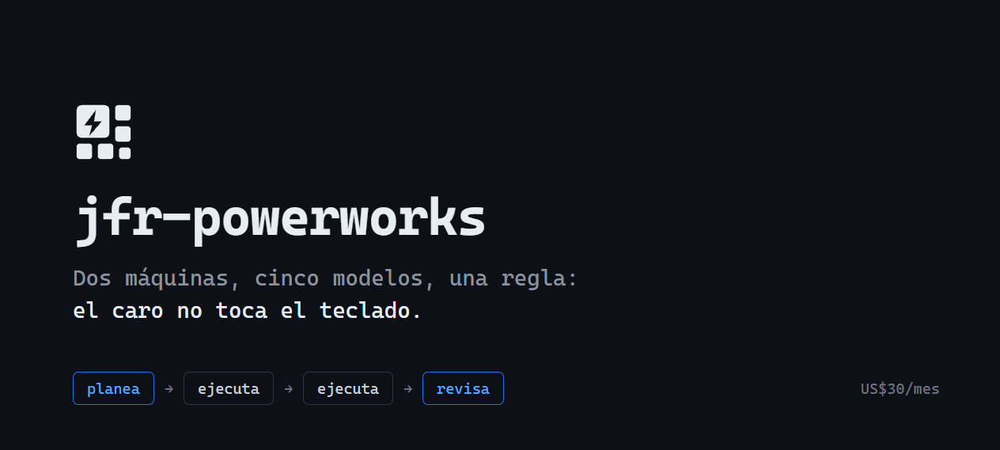

# jfr-powerworks

El sistema de agentes con el que trabajo todos los días. No es una lista de enlaces ni una plantilla teórica: son los archivos que están corriendo ahora mismo en mi torre y en mi laptop.

---

## La regla

Un modelo caro razona bien y cuesta caro por token. Un modelo barato escribe código decente si le das un plan exacto.

Así que el caro **planea y revisa**. Los baratos **ejecutan**. El caro nunca escribe el diff completo; lee el que le trajeron.

## Roles, no marcas

Son cuatro puestos de trabajo. Cualquier herramienta que cumpla el puesto sirve: lo que importa es que estén los cuatro y que cada uno se quede en el suyo.

| Rol | Qué necesita | Lo que uso yo |
|---|---|---|
| **El que razona** | Buen criterio y contexto largo. Caro por token, así que no escribe el diff | Claude Code con Opus, suscripción de US$20 |
| **El que ejecuta** | Escribir código decente **si le das un plan exacto**. Barato o con tope mensual | OpenCode Go, US$10 |
| **El de respaldo** | Otro proveedor, con otra cuota, para cuando el primero se agota | Antigravity (`agy`), de una suscripción que ya tenía por otra cosa |
| **El que lee** | Lo más barato que exista. Lee decenas de archivos y devuelve solo el extracto | Un subagente Haiku, dentro de la misma suscripción del primero |

Hay un quinto puesto opcional que sale gratis: el mismo proveedor del que razona suele tener un modelo intermedio que ejecuta dentro de la misma sesión lo que el caro planeó. En mi caso Sonnet, con `opusplan`.

**Lo que cuesta:** US$20 del que razona más US$10 del que ejecuta. **US$30 al mes.**

El de respaldo no entra en esa cuenta: viene de una suscripción que ya pagaba por otra cosa, y tiene sus propios planes y precios. Si no la tienes, el sistema funciona igual con los dos primeros; solo pierdes una cuota de reserva cuando se agote la principal.

---

## El problema que esto resuelve

Los planes de agentes por suscripción tienen topes por ventana: 5 horas, semana, mes. Cuando se alcanza uno, el CLI **termina con código de salida 0** igual que si hubiera acabado bien. El agente que lo lanzó cree que la tarea está lista. No lo está: quedó a medias, y nadie se entera hasta que algo no compila.

Pasó aquí el 21 de noviembre, a mitad de una migración.

`scripts/monitor.ps1` lee la salida mientras corre, detecta el mensaje del tope, mata el proceso y escribe `LIMITE:` en el archivo de fin. El agente que esperaba lo lee, mira en git qué alcanzó a hacer, y relanza **solo lo que falta** con el siguiente modelo de la cadena.

La cadena baja sola: pago → gratis que no entrenan con tus datos → otro proveedor → el modelo caro, como último recurso y avisando.

---

## Dónde vive el contexto

Una carpeta de markdown, versionada con git, que se abre con Obsidian. Eso es toda la memoria del sistema: no hay base vectorial, ni servidor de contexto, ni servicio que mantener.

En la raíz, `AGENTS.md`. Dentro, un tablero de pendientes que es la única fuente de qué falta, y un brief por proyecto con su **bitácora**: cada sesión escribe ahí qué hizo y qué queda, y la siguiente arranca leyéndola. Ese es el cable entre una sesión y la que viene.

Los agentes leen markdown sin integración ni clave, git te da el historial auditable, y tú puedes leer tus propias notas un domingo. Lo que pierdes es búsqueda semántica; en la práctica `grep` y un subagente barato cubren el hueco.

La regla que lo sostiene: **lo que se descubre en una sesión no se queda en la sesión.** Las conversaciones se borran; la carpeta no. Si una sesión averigua que un documento estaba equivocado o que el cliente trabaja distinto a lo que decía la nota, eso se escribe con fecha antes de cerrar.

→ **[docs/boveda.md](docs/boveda.md)** — estructura, convenciones, el relevo, y cómo montarla.

---

## Cuando el que sabe no eres tú

En un proyecto grande lo que te frena no es el código: son las decisiones que solo puede tomar el cliente. Si esas preguntas viven dispersas en chats y correos, preguntas lo mismo dos veces, pierdes respuestas que llegaron por audio, y te sientas media hora con el cliente sin la lista de lo que de verdad te bloquea.

Una sola fuente de preguntas, estructurada y viva. El documento que lee el cliente se **genera** desde ahí, nunca se escribe a mano. Y la regla: si un agente tiene una pregunta para una persona, va a ese archivo; si llega una respuesta, se registra antes de usarla.

→ **[docs/preguntas.md](docs/preguntas.md)** — el formato, la regla y qué gana el trabajo.

---

## El otro problema: el contexto

Cada skill instalada mete su descripción en **todas** las sesiones, las use o no. Medido en mi configuración: 19 skills activas = ~2.100 tokens por sesión antes de escribir una palabra. Los plugins de video sumaban 20 skills más.

`scripts/skills_toggle.ps1` mueve una skill entre la carpeta activa y una apagada. No borra nada. Se prende cuando se necesita y se apaga al terminar.

```powershell
.\skills_toggle.ps1 -Nombre differential-review -Accion on
```

Y una skill es texto que tu agente obedece, así que elegirlas es decisión de seguridad, no de comodidad. Las que rinden son las oficiales del fabricante de lo que ya usas —ahí es donde un modelo barato más se equivoca— y las de proceso. Las bibliotecas de cientos de skills generadas en masa no entran.

→ **[docs/skills.md](docs/skills.md)** — el presupuesto de contexto, qué revisar antes de instalar una, y qué descarté.

---

## Qué hay aquí

```
AGENTS.md                  El contrato. Lo lee cualquier agente que llegue sin contexto.
docs/boveda.md             La carpeta de markdown donde vive el contexto.
docs/preguntas.md          Lo que solo el cliente puede responder, en una fuente viva.
docs/skills.md             Cuáles valen la pena y cuánto contexto cuestan.
docs/ajustes.md            Los frenos: cuáles aflojar, cuáles no, y por qué.
docs/infraestructura.md    La capa opcional: un PC de casa como servidor.
scripts/delegar.ps1        Lanza la tarea delegada. Elige el modelo solo, según disponibilidad.
scripts/monitor.ps1        Tablero en vivo: avance, archivos tocados, y el aviso de tope.
scripts/skills_toggle.ps1  Prender y apagar skills sin borrarlas.
agents/lector.md           Subagente barato de solo lectura.
mods/linea-ahorro/         Línea de estado: modelo, contexto, cuota y costo, con avisos.
```

---

## AGENTS.md: el contrato

Un agente nuevo no sabe nada de tu proyecto y no debería preguntártelo todo. `AGENTS.md` vive en la raíz y responde tres cosas: dónde está el tablero de tareas, qué reglas no se negocian, y a quién se le delega qué.

Las reglas que a mí me importan, y por qué cada una existe:

- **Los secretos solo en un archivo ignorado por git.** En notas y código va el nombre, nunca el valor.
- **Nada se borra de forma permanente sin mostrarlo antes.**
- **Producción se prueba primero** con la transacción revertida o en una copia, y se pide permiso para aplicar.
- **Nada sensible a modelos gratuitos.** Algunos entrenan con lo que les mandas.

Ninguna skill de terceros pasa por encima de esto. Una skill es texto que tu agente obedece: léela entera antes de instalarla.

---

## Una capa opcional: la torre

Todo lo anterior corre en un portátil, sin servidor. Lo que sigue es lo que se montó después, cuando varias cosas tenían que correr aunque el portátil estuviera apagado: **un PC de escritorio que ya estaba en casa, encendido todo el día, con Docker.** En vez de alquilar un VPS. Cuesta la luz.

Lo que vive ahí: un enrutador que encadena proveedores de modelos gratuitos con reserva, para que cuando uno agote su cuota el siguiente responda; **transcripción de voz en local**, porque un cliente real no te manda especificaciones sino notas de voz de tres minutos; y un agente 24/7 en construcción, que corre con esos modelos gratuitos y hace lo que no necesita que estés delante.

Si no tienes una máquina así, el sistema funciona igual. Solo pierdes esas comodidades, y las dos primeras se reemplazan pagando.

→ **[docs/infraestructura.md](docs/infraestructura.md)** — qué corre ahí, las trampas del enrutador, y los reemplazos si no tienes torre.

---

## Nada de esto es sagrado

Un sistema que te traba lo terminas esquivando, y un sistema que esquivas no protege nada. Todos los umbrales viven en texto plano y se cambian editándolos: cuándo delegar, cuándo cortar la sesión, cuánto piensa el modelo, qué se pregunta antes de hacer.

Las dos que yo no aflojaría: una clave nunca va escrita dentro de un comando, porque el comando queda en un log que leen los modelos baratos a los que delegas; y lo que no se arregla con `git revert` se pregunta antes. El resto, a tu gusto.

→ **[docs/ajustes.md](docs/ajustes.md)** — cada freno, dónde se mueve y qué ganas o pierdes.

---

## Lo que esto no es

- No es un framework. No hay nada que importar.
- No es una lista de enlaces a herramientas de otros.
- No promete autonomía. Un humano revisa el diff antes de publicar.
- No te dice qué herramientas usar. Esta es la configuración que me funciona a mí; las piezas se cambian.
- No sirve tal cual: las rutas y las reglas son mías. Cópialas y cámbialas.

---

## Las piezas

Lo que uso en cada rol, con dónde conseguirlo. Los precios cambian y varían por país: entra al enlace antes de decidir.

**El que razona — [Claude Code](https://claude.com/claude-code).** El plan Pro de US$20 alcanza si delegas la ejecución; si no delegas, se te acaba a media tarde. Trae el modo donde el modelo caro planea y uno más barato ejecuta en la misma sesión, y subagentes para las lecturas.

**El que ejecuta — [OpenCode](https://opencode.ai).** El [plan Go](https://opencode.ai/go) cuesta US$10 al mes y da acceso a unas 40 modelos abiertos y cerrados, con tope por ventana de 5 horas, semana y mes. Hay modelos gratuitos sin plan, útiles para probar, pero algunos entrenan con lo que les mandas: revísalo en su consola antes de pasarles código ajeno. La clave también funciona como API compatible con OpenAI, así que sirve fuera del CLI.

**El de respaldo — [Antigravity CLI](https://antigravity.google/product/antigravity-cli).** Viene con las suscripciones de [Google AI Pro](https://one.google.com/about/google-ai-plans), que incluyen además almacenamiento y la app de Gemini. Hay varios niveles y los modelos disponibles cambian según cuál tengas, así que no todos los planes dan lo mismo en el CLI. Si ya pagas una por otra razón, el respaldo te sale sin costo adicional.

**El que lee.** No necesitas nada aparte: casi cualquier proveedor tiene un modelo pequeño y barato. Lo importante es que sea de solo lectura y devuelva extractos, no archivos completos.

**La bóveda — [Obsidian](https://obsidian.md).** Gratis para uso personal. Es solo un visor de markdown con enlaces y buscador: los archivos son tuyos y los lee cualquier cosa. Para sincronizar entre máquinas, git con el plugin Obsidian Git, o el servicio de pago de Obsidian si prefieres no tocar git.

**Para transcribir — [Whisper](https://github.com/openai/whisper), en local.** La forma cómoda es la [imagen de servicio](https://github.com/ahmetoner/whisper-asr-webservice): levantas un contenedor y le mandas el archivo. Gratis, no paga por minuto, y la voz de tus clientes no sale de tu máquina.

**Para probar en el navegador — [agent-browser](https://github.com/vercel-labs/agent-browser).** Gratis, de Vercel Labs. Le da un navegador a cualquier agente desde la terminal y devuelve la página como texto, que cuesta mucho menos que una captura. Como es un comando, lo usan también los ejecutores, no solo el que razona.

## Requisitos

Windows con PowerShell 5.1, git, y los CLI que uses como ejecutores. Los scripts no tienen dependencias.

---

MIT. Si te sirve algo de aquí, úsalo.
